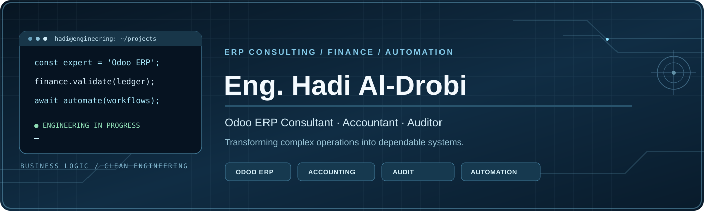
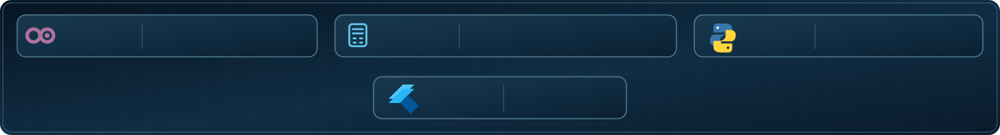
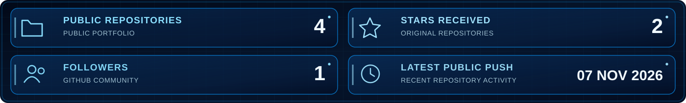

**ODOO ERP · ACCOUNTING · AUDIT · AUTOMATION**

*Business solutions. Financial insight. Modern development.*

---

## Professional Profile

I'm **Eng. Hadi Al-Drobi**, an Odoo ERP consultant, accountant and auditor. I translate business and financial requirements into structured workflows, dependable reporting and practical digital systems, combining accounting expertise with software development.

## Core Expertise

| Discipline | Specialization |
| :--- | :--- |
| **Odoo ERP** | Implementation, process analysis, customization and automation |
| **Accounting & Audit** | Financial reports, reconciliations and internal controls |
| **Software Engineering** | Python, JavaScript, XML, Dart, Flutter and APIs |
| **Data & Delivery** | PostgreSQL, Git, GitHub, Excel and testing |

## Selected Work

**YAFA — Multi-Service Platform**  
Private development project integrating a Flutter customer application with Odoo-based service operations, bookings and customer–provider communication.

**ERP & Accounting Solutions**  
Business workflows across sales, purchasing, accounting, projects, financial reporting and audit-oriented controls.

Project summaries are deliberately high level; private code, internal architecture and client information are not published.

---

## Repository Map

| Repository | Role | Working rule |
| :--- | :--- | :--- |
| **Yodootec-ERP** | Yodoo ERP, SaaS, accounting, travel, website and platform integrations | Product repository; enter through `main` and its governance docs |
| **yafa-odoo** | TC/تِك Odoo 19 backend | Product repository; current resume source is `consolidation/tc-backend-canonical-20261107` |
| **YAFA-Customer-App** | TC/تِك Flutter customer application | Product repository; `main` is the stable entrypoint and feature work stays isolated |
| **git-practice-demo** | Git learning sandbox | Training only — never deploy |
| **local-git-demo** | Local Git learning sandbox | Training only — never deploy |
| **oapi-sdk-python** | External/reference SDK workspace | Reference/integration dependency; not a Yodoo or TC product source |

### Repository boundary rule

Product source must stay in its owning repository. Historical branches are evidence, not automatic source-of-truth. New work starts from the repository README/GOVERNANCE instructions, not from whichever branch appears newest.

---

## Current Focus

- Building maintainable Odoo ERP applications and integrations
- Developing scalable multi-service platforms
- Improving accounting controls and financial reporting
- Strengthening automated testing and engineering reliability

## Connect

I welcome professional collaboration on **Odoo ERP, accounting technology, business automation and digital transformation**.

[View repositories](https://github.com/Eng-Hadi-Ali?tab=repositories)

---

## Digital Engineering Metrics

Public GitHub statistics. Updated automatically when scheduled GitHub Actions runs successfully.

---

**ERP · FINANCE · ENGINEERING · AUTOMATION**

