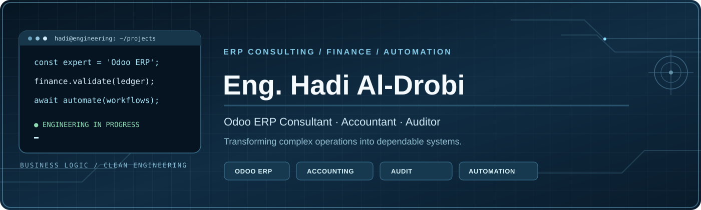

### Odoo ERP Consultant · Accountant · Auditor · Business Automation

*Engineering reliable workflows at the intersection of ERP, finance and software.*

---

## Professional Overview

I'm **Eng. Hadi Al-Drobi**, an Odoo ERP consultant, accountant and auditor. I translate business and financial requirements into structured workflows, dependable reporting and practical digital systems, combining accounting expertise with software development.

## Core Expertise

| Discipline | Specialization |
| :--- | :--- |
| **Odoo ERP** | Implementation, process analysis, customization and automation |
| **Accounting & Audit** | Financial reports, reconciliations and internal controls |
| **Software Engineering** | Python, JavaScript, XML, Dart, Flutter and APIs |
| **Data & Delivery** | PostgreSQL, Git, GitHub, Excel and testing |

## Selected Work

**YAFA — Multi-Service Platform**  
Private development project integrating a Flutter customer application with Odoo-based service operations, bookings and customer–provider communication.

**ERP & Accounting Solutions**  
Business workflows across sales, purchasing, accounting, projects, financial reporting and audit-oriented controls.

Project summaries are deliberately high level; private code, internal architecture and client information are not published.

---

## Engineering Activity

Activity cards are provided by a third-party service and reflect publicly accessible GitHub data; private development activity may not appear.

## Current Focus

- Building maintainable Odoo ERP applications and integrations
- Developing scalable multi-service platforms
- Improving accounting controls and financial reporting
- Strengthening automated testing and engineering reliability

## Connect

I welcome professional collaboration on **Odoo ERP, accounting technology, business automation and digital transformation**.

[View repositories](https://github.com/Eng-Hadi-Ali?tab=repositories)

**ERP · FINANCE · ENGINEERING · AUTOMATION**

